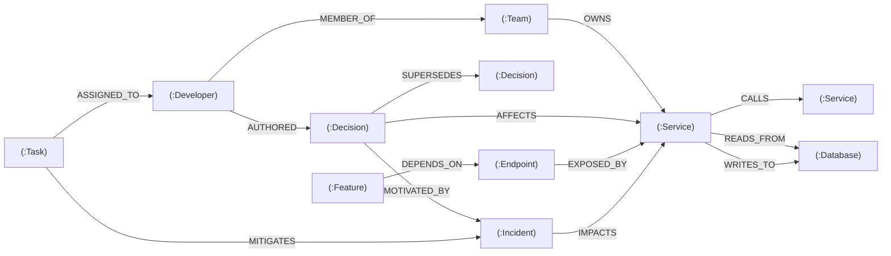
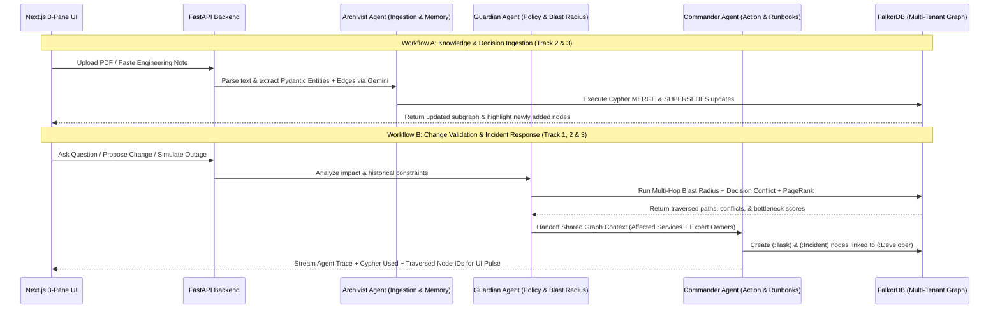

# 🚀 NexusGraph (CortexOps) — Pre-Hackathon Architecture & Strategy Blueprint

> **Event:** Graph Hacks: Context for AI Agents (WeMakeDevs x FalkorDB)  
> **Dates:** October 15, 2026 (12:01 AM IST) – October 18, 2026 (11:59 PM IST)  
> **Builder:** Gourav Das (Solo Participation)  
> **Target Tracks:** **All 3 Tracks** (`Agents That Act on Connected Data`, `Agent Memory and Coordination`, `Company Brain`) + **Side Prize** (`Best Blog Post`)

---

## 1. Executive Summary & Core Pitch

### The Problem
Software engineering teams suffer from fragmented context: architectural decisions live in scattered PDFs/notes, microservice dependencies live in config files, incident post-mortems live in old tickets, and ownership lives in people's heads. Standard RAG chatbots fail at engineering intelligence because vector similarity only matches isolated text chunks—it cannot traverse a 4-hop chain of service dependencies, distinguish active decisions from deprecated ones, or compute the downstream blast radius of an outage.

### The Solution: **NexusGraph**
**NexusGraph** is an Autonomous Engineering Brain, Decision-Memory, and Incident-Impact Agent System powered by **FalkorDB**. It unifies **People**, **Architectural Decisions**, **Microservices/APIs**, and **Incidents/Tasks** into a single real-time property graph. Using a coordinated 3-agent architecture (**Archivist**, **Guardian**, and **Commander**), NexusGraph ingests unstructured engineering docs into FalkorDB, remembers evolving architectural decisions across sessions, runs multi-hop Cypher traversals and graph algorithms (`PageRank`, `ShortestPath`) to calculate blast radius, and takes automated mitigation actions with full visual path traceability.

---

## 2. How NexusGraph Wins All 3 Tracks

| Track | Prize | How NexusGraph Directly Satisfies Judging Criteria |
| :--- | :--- | :--- |
| **Track 01: Agents That Act on Connected Data** | iPhone 18 Pro | Uses multi-hop Cypher traversals (`*1..5`) and FalkorDB graph algorithms (`PageRank`, `shortestPath`) as agent tools to calculate outage blast radius, detect single points of failure, and automatically create/assign mitigation `(:Task)` nodes in the graph. |
| **Track 02: Agent Memory and Coordination** | PS5 + GTA VI | Features 3 specialized agents (**Archivist**, **Guardian**, **Commander**) coordinating via shared FalkorDB graph state. Tracks temporal & episodic memory using `(:Decision)-[:SUPERSEDES]->(:Decision)` across sessions and uses FalkorDB's **multi-graph tenant isolation** (`db.select_graph(workspace_id)`). |
| **Track 03: Company Brain** | M6 Mac Mini | Connects `(:Developer)`, `(:Team)`, `(:Decision)`, `(:Service)`, `(:Endpoint)`, and `(:Feature)` in one graph. Answers cross-org questions (*"Who owns this failing checkout flow and why did we change its auth last month?"*) with exact graph path provenance. |
| **Side Prize: Best Blog Post** | AirPods 5 | Technical deep-dive blog post on Dev.to / Hashnode / Medium titled: *"Why Vector RAG Fails at Engineering Context: Building a Multi-Agent Engineering Brain with FalkorDB, FastAPI, and Gemini."* |

---

## 3. Custom-Tailored Tech Stack

Designed specifically around Gourav's strongest production skills:

* **Frontend (UI & Visual Graph Canvas):**
  * **Next.js (App Router) + React 19 + Tailwind CSS** (Dark-mode command center aesthetic inspired by *FinPulse SaaS*).
  * **Graph Visualization:** `react-force-graph-2d` (or `@xyflow/react`) to render live FalkorDB nodes/edges and **highlight/pulse the exact path** traversed by the agent on every query.
  * **Icons & UI Components:** `lucide-react` + clean custom Tailwind panels.
* **Backend (Agent & Graph API Engine):**
  * **FastAPI (Python) + Uvicorn** with modular structure (`app/core`, `app/models`, `app/services`, `app/agents`, `app/routers`).
  * **Pydantic v2** for strict entity/relationship extraction schemas and API responses.
  * **PyPDF** for extracting text from uploaded architecture/post-mortem PDFs.
* **AI & Orchestration:**
  * **Google Gemini API (`google-genai` / `langchain-google-genai`)** for structured entity extraction, Cypher tool selection, and multi-agent reasoning.
* **Primary Database:**
  * **FalkorDB (`falkordb-py` official Python client)** running via Docker (`falkordb/falkordb:latest`) locally and deployed via **FalkorDB Cloud** or **AWS EC2** (using Docker) for live judging.

---

## 4. FalkorDB Property Graph Data Model

### Node Labels & Properties

| Node Label | Key Properties | Example Node |
| :--- | :--- | :--- |
| `Developer` | `id`, `name`, `role`, `email`, `expertise` | `(:Developer {name: "Gourav Das", role: "Lead Architect"})` |
| `Team` | `id`, `name`, `slack_channel`, `on_call` | `(:Team {name: "Core Payments", slack_channel: "#payments-eng"})` |
| `Service` | `id`, `name`, `tier`, `status`, `language` | `(:Service {name: "Payment-API", tier: "tier-1", status: "healthy"})` |
| `Database` | `id`, `name`, `engine`, `region`, `status` | `(:Database {name: "Postgres-Primary", engine: "PostgreSQL"})` |
| `Endpoint` | `id`, `path`, `method`, `rate_limit` | `(:Endpoint {path: "/v1/checkout", method: "POST"})` |
| `Feature` | `id`, `name`, `sla_tier`, `revenue_impact` | `(:Feature {name: "Instant Checkout", sla_tier: "99.99%"})` |
| `Decision` | `id`, `title`, `summary`, `status`, `timestamp`, `source_doc` | `(:Decision {id: "DEC-104", title: "Deprecate Sync Webhooks", status: "active"})` |
| `Incident` | `id`, `title`, `severity`, `status`, `timestamp` | `(:Incident {id: "INC-402", title: "Stripe Webhook Rate Limit Outage", severity: "SEV-1"})` |
| `Task` | `id`, `title`, `priority`, `status`, `created_by_agent` | `(:Task {id: "TSK-88", title: "Rollback Auth Token TTL", priority: "P0"})` |

### Directed Relationships (Edges)



---

## 5. Core Cypher Queries & Graph Algorithms

> [!IMPORTANT]
> Rule #10 requires documenting the exact Cypher queries and graph algorithms the product depends on in the README, and Rule #12 requires you to understand and explain them.

### 1. Multi-Hop Downstream Blast Radius (Track 1)
Finds every downstream service, endpoint, and user-facing feature up to 5 hops away that will break if a target database or service fails, along with the owning team.
```cypher
MATCH path = (target {name: $target_name})<-[:DEPENDS_ON|CALLS|READS_FROM|WRITES_TO|EXPOSED_BY*1..5]-(affected)
OPTIONAL MATCH (owner:Team)-[:OWNS]->(affected)
RETURN affected.name AS component,
       labels(affected) AS component_type,
       length(path) AS hops_away,
       [n IN nodes(path) | n.name] AS dependency_chain,
       owner.name AS owning_team
ORDER BY hops_away ASC
```

### 2. Temporal Decision Memory & Supersedes Chain (Track 2)
Retrieves the decision history for a service, explicitly separating active architectural rules from deprecated ones (`SUPERSEDES`) and linking them to the past incidents that motivated them.
```cypher
MATCH (d:Decision)-[:AFFECTS]->(s:Service {name: $service_name})
OPTIONAL MATCH (d)-[:SUPERSEDES]->(old:Decision)
OPTIONAL MATCH (d)-[:MOTIVATED_BY]->(inc:Incident)
OPTIONAL MATCH (author:Developer)-[:AUTHORED]->(d)
RETURN d.id AS id,
       d.title AS decision_title,
       d.summary AS rationale,
       d.status AS status,
       old.title AS superseded_decision,
       inc.title AS triggered_by_incident,
       author.name AS authored_by,
       d.timestamp AS timestamp
ORDER BY d.timestamp DESC
```

### 3. Cross-Org Expertise & Ownership Resolver (Track 3)
Traces from a high-level business feature down through endpoints and microservices to identify which developer has the deepest historical context (authored decisions + team ownership).
```cypher
MATCH (f:Feature {name: $feature_name})-[:DEPENDS_ON|EXPOSED_BY|CALLS*1..4]->(s:Service)
MATCH (dev:Developer)-[:AUTHORED]->(d:Decision)-[:AFFECTS]->(s)
OPTIONAL MATCH (dev)-[:MEMBER_OF]->(t:Team)-[:OWNS]->(s)
RETURN dev.name AS developer,
       dev.role AS role,
       t.name AS team,
       collect(DISTINCT s.name) AS services_touched,
       count(DISTINCT d) AS decisions_count,
       collect(DISTINCT d.title) AS authored_decisions
ORDER BY decisions_count DESC
```

### 4. Shortest Path Root-Cause Connection (Graph Algorithm)
When two seemingly unrelated components fail simultaneously, finds the shortest connecting path in the graph to isolate the shared root dependency.
```cypher
MATCH (a {name: $component_a}), (b {name: $component_b})
MATCH p = shortestPath((a)-[*..6]-(b))
RETURN [n IN nodes(p) | {name: n.name, type: labels(n)[0]}] AS shared_root_path,
       [r IN relationships(p) | type(r)] AS relationship_types
```

### 5. PageRank Critical Bottleneck Detection (Graph Algorithm)
Executes FalkorDB's built-in PageRank algorithm over the service dependency graph to mathematically rank single points of failure.
```cypher
CALL algo.pageRank('Service', 'CALLS')
YIELD node, score
RETURN node.name AS service_name, node.tier AS tier, node.status AS status, score
ORDER BY score DESC
LIMIT 5
```

### 6. Automated Agent Action — Write Mitigation Tasks to Graph (Track 1 & 2)
When the Commander Agent responds to an incident, it doesn't just reply in chat—it mutates the graph to record the action and assign the right developer.
```cypher
MATCH (inc:Incident {id: $incident_id})
MATCH (dev:Developer {name: $developer_name})
MERGE (t:Task {id: $task_id})
SET t.title = $task_title,
    t.priority = $priority,
    t.status = 'open',
    t.created_by_agent = 'CommanderAgent',
    t.timestamp = $timestamp
MERGE (t)-[:MITIGATES]->(inc)
MERGE (t)-[:ASSIGNED_TO]->(dev)
RETURN t.id AS task_id, dev.name AS assigned_to
```

---

## 6. Multi-Agent Coordination Architecture



### How the 3 Agents Share State in FalkorDB:
1. **Archivist Agent (`archivist.py`):** Converts unstructured notes, PR descriptions, or PDFs into structured graph mutations (`MERGE` nodes, mark old decisions as `deprecated` via `[:SUPERSEDES]`).
2. **Guardian Agent (`guardian.py`):** Queries FalkorDB using multi-hop Cypher tools to verify if a proposed engineering change violates an active `(:Decision)` or impacts a `tier-1` `(:Feature)`.
3. **Commander Agent (`commander.py`):** Reads the blast-radius subgraph identified by the Guardian, finds the best `(:Developer)` using the Expertise Resolver query, and writes actionable `(:Task)` nodes directly back into FalkorDB.

---

## 7. Next.js 3-Pane Command Center UI Specification

A single-screen, high-contrast dark-mode workspace so judges see everything working together without clicking through 10 pages:

1. **Left Panel — Workspace, Ingestion & Simulation Controls:**
   * **Multi-Graph Tenant Switcher:** Switch between `FinPulse-Prod` (Fintech SaaS preset), `ShopSphere-Core` (E-Commerce preset), or create a new isolated tenant graph (`db.select_graph()`).
   * **Knowledge & Memory Ingestor:** Textarea + PDF upload button to feed new architectural decisions or incident notes into the Archivist Agent in real time.
   * **1-Click Demo Scenarios:**
     * `🔴 Simulate Postgres-Primary Latency Spike`
     * `⚠️ Propose Sync Webhook Change on Payment-API`
     * `🔍 Find Root Cause: Checkout + Portfolio Errors`
     * `🏆 Run PageRank Bottleneck Audit`
2. **Center Panel — Interactive Live Graph Canvas:**
   * Color-coded nodes by label (`Service`, `Database`, `Decision`, `Developer`, `Feature`, `Incident`, `Task`).
   * **Live Traversal Highlighting:** When the backend returns a response, it includes `highlighted_nodes: [...]` and `highlighted_edges: [...]`. The canvas dims non-relevant nodes to 20% opacity and pulses the exact multi-hop path the agent traversed!
   * Node Inspector drawer on click (shows properties and direct neighbors).
3. **Right Panel — Multi-Agent Console & Explainability Trace:**
   * Chat & Action feed showing badges for **Archivist**, **Guardian**, and **Commander** handoffs.
   * **"Trace & Cypher Proof" Accordion on Every Answer:**
     * Displays the exact **Cypher query** executed.
     * Shows the **Graph Path** (`Feature: Instant Checkout -> Endpoint: /v1/checkout -> Service: Payment-API -> Decision: DEC-104`).
     * Shows **Query Latency** (`Executed in 3.8ms on FalkorDB`).

---

## 8. 4-Day Solo Execution Plan (Oct 15 – Oct 18, 2026)

> [!NOTE]
> All actual code and UI implementation starts on **October 15 at 12:01 AM IST** in compliance with Rule #8.

| Day | Focus Area | Concrete Deliverables |
| :--- | :--- | :--- |
| **Day 1 (Oct 15)** | **FalkorDB Setup, Seed Datasets & Cypher Engine** | 1. Run `falkordb/falkordb` in Docker (`6379` & `3000`).<br>2. Build FastAPI connection manager supporting multi-graph selection (`select_graph`).<br>3. Create rich seed script (`seed_graph.py`) for `FinPulse-Prod` and `ShopSphere-Core` (35+ nodes, 60+ edges).<br>4. Implement and test all 6 core Cypher queries & `algo.pageRank` / `shortestPath`. |
| **Day 2 (Oct 16)** | **3-Agent Pipeline (FastAPI + Gemini + Pydantic)** | 1. Build **Archivist Agent** (PDF/Text $\rightarrow$ Gemini Structured Output $\rightarrow$ Cypher `MERGE` + `SUPERSEDES`).<br>2. Build **Guardian Agent** & **Commander Agent** with tool-calling over the 6 Cypher queries.<br>3. Ensure every API response returns `{ answer, agent_trace, cypher_queries, highlighted_node_ids }`. |
| **Day 3 (Oct 17)** | **Next.js 3-Pane Dashboard & Visual Path Highlighting** | 1. Scaffold Next.js App Router + Tailwind dark-mode 3-pane layout.<br>2. Integrate interactive graph canvas (`react-force-graph-2d`) with live node/edge path highlighting.<br>3. Wire up the Tenant Switcher, PDF/Note Memory Ingestor, 1-Click Scenario buttons, and Cypher Trace Inspector. |
| **Day 4 (Oct 18)** | **Deployment, README, Demo Video & Blog Post** | 1. Deploy Backend + FalkorDB (AWS EC2 / FalkorDB Cloud) and Frontend (Vercel).<br>2. Write comprehensive `README.md` with Mermaid schema diagrams, setup steps, Cypher queries, and AI disclosure.<br>3. Record crisp 3-minute demo video showing all 3 tracks in action.<br>4. Publish technical blog post for the AirPods 5 side prize and submit before 11:59 PM IST! |

---

## 9. Submission & Compliance Checklist (Rule #10 & #11)

- [ ] **Public GitHub Repository** with clean commit history starting Oct 15.
- [ ] **FalkorDB as Primary Database** doing indispensable multi-hop work (Rule #2 & #3).
- [ ] **README.md** containing:
  - [ ] Architecture & Graph Data Model diagram.
  - [ ] All core Cypher queries and Graph Algorithms (`PageRank`, `shortestPath`) explained.
  - [ ] One-command local Docker setup (`docker compose up`) + Live Deployment link.
  - [ ] Explicit declaration of entering **Track 01, Track 02, and Track 03**.
  - [ ] **AI Coding Assistant Disclosure** (Rule #11): Transparent statement noting that Google Antigravity / AI assistants were used for development acceleration while architecture, graph modeling, and verification were directed by Gourav Das.
- [ ] **Demo Video** (3–4 mins) demonstrating live ingestion, cross-session memory conflict detection, blast-radius traversal, and visual path highlighting.
- [ ] **Blog Post Link** submitted for the Best Blog Post side prize.

