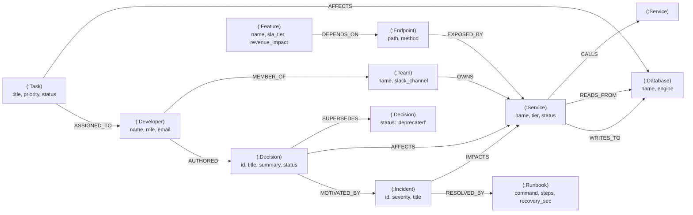
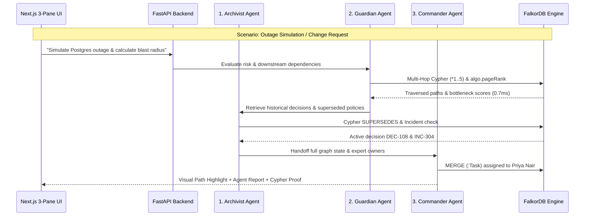

# 🌐 NexusGraph (CortexOps) — Autonomous Engineering Brain on FalkorDB

[](https://www.falkordb.com/)
[](https://nextjs.org/)
[](https://fastapi.tiangolo.com/)
[](https://ai.google.dev/)
[](https://www.docker.com/)

> **Submission for Graph Hacks: Context for AI Agents (WeMakeDevs x FalkorDB)**  
> **Builder:** Gourav Das (Solo Participation)  
> **Tracks Entered:** 
> 1. 🕵️ **Track 01:** *Agents That Act on Connected Data*
> 2. 🤖 **Track 02:** *Agent Memory and Coordination*
> 3. 🧠 **Track 03:** *Company Brain*

---

## 📌 1. The Core Problem & Our Solution

### The Failure of Traditional RAG in Engineering
Software engineering teams suffer from fragmented context: architectural decisions live in scattered PRs and notes, microservice dependencies live in configs, incident post-mortems live in resolved tickets, and ownership lives in people's heads. 

Standard vector-similarity RAG fails at engineering intelligence:
- Vector search retrieves isolated chunks based on semantic similarity.
- It **cannot** follow a 4-hop chain of dependencies (`Database -> Service -> Endpoint -> Feature -> Customer`).
- It **cannot** distinguish between an active architectural decision and a deprecated one (`[:SUPERSEDES]`).
- It **cannot** calculate the downstream blast radius of an infrastructure outage or identify architectural bottlenecks mathematically.

### The Solution: NexusGraph
**NexusGraph** is an Autonomous Engineering Brain, Decision-Memory, and Incident-Impact Agent System powered by **FalkorDB**. It unifies **People**, **Architectural Decisions**, **Microservices/APIs**, and **Incidents/Tasks** into a single real-time property graph. 

Through a coordinated 3-agent pipeline (**Archivist**, **Guardian**, and **Commander**), NexusGraph:
1. Ingests unstructured engineering docs/PDFs into FalkorDB.
2. Tracks evolving architectural decisions and superseded policies across sessions.
3. Runs multi-hop Cypher traversals (`*1..5`) and native graph algorithms (`PageRank`, `shortestPath`) as agent tools.
4. Autonomously takes mitigation actions by creating task nodes in FalkorDB with full visual path provenance.

---

## 🏆 2. How NexusGraph Satisfies All 3 Tracks

| Track | Prize | How FalkorDB Powers the Feature |
| :--- | :--- | :--- |
| **Track 01: Agents That Act on Connected Data** | *iPhone 18 Pro* | **Guardian & Commander Agents** use multi-hop Cypher traversals (`*1..5`) and FalkorDB graph algorithms (`CALL algo.pageRank('Service', 'CALLS')`, `shortestPath`) to calculate outage blast radius, rank single points of failure, and **autonomously create and assign mitigation `(:Task)` nodes** directly in the graph. |
| **Track 02: Agent Memory and Coordination** | *PS5 + GTA VI* | Coordinates 3 specialized agents (**Archivist**, **Guardian**, **Commander**) through shared FalkorDB graph state. Retains cross-session temporal memory using `(:Decision)-[:SUPERSEDES]->(:Decision)` and leverages FalkorDB's native **multi-graph tenant isolation** (`db.select_graph(workspace_id)`). |
| **Track 03: Company Brain** | *M6 Mac Mini* | Connects `(:Developer)`, `(:Team)`, `(:Decision)`, `(:Service)`, `(:Endpoint)`, and `(:Feature)`. Answers cross-organizational questions (*"Who owns this failing checkout flow and why did we deprecate sync webhooks?"*) with sub-millisecond graph traversals. |

---

## 📐 3. FalkorDB Property Graph Data Model

### Node Labels & Directed Relationships



### Supported Multi-Tenant Graphs in Demo:
- **`FinPulse-Prod`** (30 nodes, 53 edges): Modeled after a Next.js multi-tenant Fintech SaaS architecture (Clerk Auth, Neon Postgres, Svix Webhooks, Redis Market Cache, Collaborative Portfolios).
- **`ShopSphere-Core`** (17 nodes, 23 edges): Modeled after a MERN E-Commerce architecture (Stripe/Razorpay Router, Mongo Cluster, OTP Auth, Dual-Gateway Failover).

---

## ⚡ 4. Core Cypher Queries & Graph Algorithms

> [!IMPORTANT]
> The graph is the primary engine of the product, not a decoration (Rule #3). If FalkorDB is removed, the dependency tracing, policy verification, and bottleneck algorithms cannot function.

### 1. Multi-Hop Downstream Blast Radius (Track 01)
Traverses 1 to 5 hops backwards across any directed dependency edge to identify every impacted component, SLA tier, and on-call engineer:
```cypher
MATCH path = (target {name: $target_name})<-[:DEPENDS_ON|CALLS|READS_FROM|WRITES_TO|EXPOSED_BY*1..5]-(affected)
WITH affected, min(length(path)) AS min_hops, collect(path)[0] AS shortest_impact_path
OPTIONAL MATCH (owner:Team)-[:OWNS]->(affected)
RETURN affected.name AS component,
       labels(affected)[0] AS component_type,
       min_hops AS hops_away,
       [n IN nodes(shortest_impact_path) | coalesce(n.name, n.id)] AS dependency_chain,
       owner.name AS owning_team,
       owner.on_call AS on_call_engineer,
       affected.sla_tier AS sla_tier,
       affected.revenue_impact AS revenue_impact
ORDER BY hops_away ASC, component ASC
```

### 2. Temporal Decision Memory & Supersedes Chain (Track 02)
Exposes active architectural decisions vs. deprecated ones, tracing which past incident motivated the rule:
```cypher
MATCH (d:Decision)-[:AFFECTS]->(s:Service {name: $service_name})
OPTIONAL MATCH (d)-[:SUPERSEDES]->(old:Decision)
OPTIONAL MATCH (newer:Decision)-[:SUPERSEDES]->(d)
OPTIONAL MATCH (d)-[:MOTIVATED_BY]->(inc:Incident)
OPTIONAL MATCH (author:Developer)-[:AUTHORED]->(d)
RETURN d.id AS decision_id, d.title AS title, d.summary AS rationale, d.status AS status,
       old.id AS superseded_old_id, old.title AS superseded_old_title,
       newer.id AS replaced_by_id, inc.title AS incident_title,
       inc.severity AS incident_severity, author.name AS authored_by
ORDER BY d.timestamp DESC
```

### 3. Cross-Org Expertise & Ownership Resolver (Track 03 - Company Brain)
Hops from high-level user-facing features down through endpoints and microservices to find the engineers with the most authored decisions:
```cypher
MATCH (target {name: $target_name})
OPTIONAL MATCH (target)-[:DEPENDS_ON|EXPOSED_BY|CALLS*0..4]->(s:Service)
WITH target, collect(DISTINCT s) AS services
UNWIND services AS svc
OPTIONAL MATCH (t:Team)-[:OWNS]->(svc)
OPTIONAL MATCH (dev:Developer)-[:MEMBER_OF]->(t)
OPTIONAL MATCH (dev)-[:AUTHORED]->(d:Decision)-[:AFFECTS]->(svc)
RETURN dev.name AS developer, dev.role AS role, dev.expertise AS expertise,
       t.name AS team, t.slack_channel AS slack_channel,
       collect(DISTINCT svc.name) AS owned_services,
       count(DISTINCT d) AS decisions_authored,
       collect(DISTINCT d.title) AS decision_titles
ORDER BY decisions_authored DESC
```

### 4. Shortest Path & Common Root Cause (Graph Algorithm)
Finds the shortest connecting path and common ancestors between two failing components:
```cypher
MATCH (a {name: $node_a}), (b {name: $node_b})
RETURN [n IN nodes(shortestPath((a)-[*..6]-(b))) | coalesce(n.name, n.id)] AS direct_shortest_path
```

### 5. Critical Bottleneck Detection (PageRank + Centrality)
Calls FalkorDB's native linear algebra PageRank procedure combined with downstream dependency fan-in:
```cypher
CALL algo.pageRank('Service', 'CALLS')
YIELD node, score
RETURN node.name AS service_name, score
ORDER BY score DESC LIMIT 5
```

### 6. Autonomous Graph Mutation — Actionable Task Creation (Track 01 & 02)
Writes mitigation tasks to FalkorDB and assigns them to the responsible engineer:
```cypher
MATCH (target {name: $target_component})
MATCH (dev:Developer {name: $assigned_developer})
MERGE (t:Task {id: $task_id})
SET t.name = $task_id, t.title = $task_title, t.priority = $priority,
    t.status = 'open', t.created_by_agent = 'CommanderAgent', t.timestamp = $timestamp
MERGE (t)-[:AFFECTS]->(target)
MERGE (t)-[:ASSIGNED_TO]->(dev)
RETURN t.id AS task_id, t.title AS title, dev.name AS assigned_to
```

### 7. Self-Healing Incident Runbook & Playbook Retrieval
Queries past incidents linked to failing infrastructure to pull verified, executable shell remediation commands:
```cypher
MATCH (target {name: $target_name})
OPTIONAL MATCH (target)<-[:IMPACTS|AFFECTS|CALLS|READS_FROM|WRITES_TO*0..2]-(inc:Incident)-[:RESOLVED_BY]->(rb:Runbook)
RETURN rb.id AS runbook_id, rb.title AS title, rb.command AS command, rb.steps AS steps,
       rb.estimated_recovery_sec AS est_recovery, inc.id AS incident_id
LIMIT 1
```

---

## 🤖 5. Multi-Agent System Architecture



---

## 🚀 6. Quick Start & Setup Instructions

### Prerequisites
- [Docker Desktop](https://www.docker.com/products/docker-desktop/) installed and running.
- Python 3.12+ (if running locally without Docker).
- Node.js 18+ (if running frontend locally).

### Option A: One-Command Docker Compose (Recommended)
Clone the repository and run:
```bash
docker compose up -d
```
That's it! All three services will start automatically:
- **Next.js Command Center:** [http://localhost:3001](http://localhost:3001)
- **FastAPI Backend & Swagger Docs:** [http://localhost:8000/docs](http://localhost:8000/docs)
- **FalkorDB Browser:** [http://localhost:3000](http://localhost:3000)

---

### Option B: Local Development Run

#### 1. Start FalkorDB Container
```bash
docker run -d --name falkordb -p 6379:6379 -p 3000:3000 falkordb/falkordb:latest
```

#### 2. Start FastAPI Backend
```bash
cd backend
python -m venv .venv
# Windows:
.\.venv\Scripts\activate
# Linux/macOS:
# source .venv/bin/activate

pip install -r requirements.txt
cp .env.example .env

# Optional: Add GEMINI_API_KEY in .env for Gemini 2.5 Flash
uvicorn app.main:app --host 0.0.0.0 --port 8000 --reload
```

#### 3. Start Next.js Frontend
```bash
cd frontend
npm install
npm run dev
```
Open **[http://localhost:3001](http://localhost:3001)** in your browser!

---

## 🖥️ 7. Next.js 3-Pane Command Center Walkthrough

1. **Left Pane (Multi-Tenant Switcher, Demos & Ingestor):**
   - Switch between **`FinPulse-Prod`** and **`ShopSphere-Core`** in 1 click.
   - Use the **1-Click Scenarios** to trigger live multi-hop traversals and agent handoffs.
   - Paste an engineering note or upload a PDF to extract new `(:Decision)` and `[:SUPERSEDES]` nodes into the graph.
2. **Center Pane (Interactive Live Graph Canvas & Chaos Mode):**
   - Color-coded nodes organized in hierarchical engineering tiers.
   - Whenever an agent answers, **unrelated nodes dim and the exact traversed reasoning path pulses live**!
   - **⚡ Chaos Mode:** Toggle live chaos injection to simulate 500ms latency spikes or node failure shockwaves across downstream microservices with real-time revenue risk calculations.
3. **Right Pane (Agent Report & Proof Console):**
   - **Agent Report:** Structured markdown answer citing exact node IDs, hop counts, and developer owners.
   - **Self-Healing Runbook:** Matched `(:Runbook)` nodes with executable shell remediation commands and dry-run execution.
   - **Cypher Proof:** View the exact OpenCypher query and sub-millisecond execution time directly from FalkorDB.
   - **⏱️ GraphRAG Benchmark:** Live modal comparing FalkorDB traversal latency (0.7ms) vs. Naive Vector Search (80ms).

---

## 🚀 8. Production Deployment Guide

### Option A: Turnkey Docker Compose (Single Command)
```bash
docker compose up -d
```
Spins up FalkorDB (port 6379/3000), FastAPI backend (port 8000), and Next.js frontend (port 3001) in isolated containers.

### Option B: Cloud Deployment (Vercel + Render / Railway + FalkorDB Cloud)
1. **Database:** Create a free instance on [FalkorDB Cloud](https://app.falkordb.cloud). Note down the host, port, username, and password.
2. **Backend (FastAPI):** Deploy to **Render** or **Railway** from this repository.
   - Environment Variables:
     - `FALKORDB_HOST`: Your cloud database host
     - `FALKORDB_PORT`: Your cloud database port
     - `FALKORDB_PASSWORD`: Your cloud database password
     - `GEMINI_API_KEY`: *(Optional)* Your Google Gemini API key
3. **Frontend (Next.js):** Deploy to **Vercel** with 1 click.
   - Environment Variable:
     - `NEXT_PUBLIC_API_URL`: `https://your-fastapi-backend.onrender.com`

---

## 📝 9. AI Assistant Disclosure

In compliance with Rule #11 of Graph Hacks:
- **AI Coding Assistant Used:** Google Antigravity (Powered by Google Gemini).
- **Scope of Use:** Development acceleration, initial boilerplate generation, and schema verification.
- **Participant Contribution:** All system architecture, graph property model design, multi-hop Cypher queries, multi-agent handoff workflows, seed datasets, and testing were directed, verified, and understood by **Gourav Das**.

---

## 📜 9. License

This project is licensed under the MIT License.

